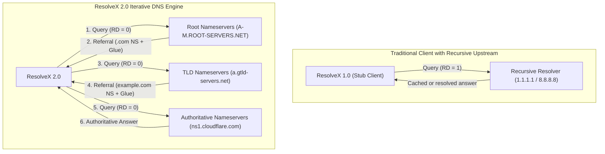
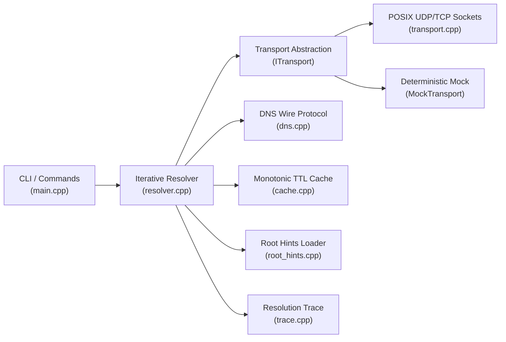

# ResolveX 2.0 — Production-Quality Iterative DNS Resolver

ResolveX is an iterative Domain Name System (DNS) resolution engine and protocol tool written from scratch in C++17.

Unlike standard client stub resolvers that forward queries to an upstream recursive resolver (such as `1.1.1.1` or `8.8.8.8`) and blindly trust the answer, ResolveX implements the **iterative DNS resolution algorithm** described in RFC 1034 and RFC 1035. Starting from authoritative root nameservers defined in a root hints database, ResolveX independently queries nameservers at each level of the DNS hierarchy, parses referrals, extracts and validates in-bailiwick glue records, resolves nameserver addresses without glue when necessary, chases CNAME aliases, and maintains an in-memory and persistent monotonic TTL cache.

```
ResolveX/
├── CMakeLists.txt              CMake build configuration (C++17, cross-platform)
├── config/
│   └── root.hints              Authoritative root server hints (IANA/InterNIC)
├── include/
│   ├── dns.hpp                 Wire format definitions, encoding, and zero-copy bounds parsing
│   ├── transport.hpp           POSIX network transport (UDP/TCP/IPv4/IPv6) & MockTransport
│   ├── root_hints.hpp          Root server database loader and candidate selector
│   ├── cache.hpp               Bounded monotonic TTL cache with remaining-TTL accounting
│   ├── trace.hpp               Real-time resolution trace collector and JSON serializer
│   └── resolver.hpp            Iterative referral engine, glue processor, and CNAME tracker
├── src/
│   ├── dns.cpp                 DNS packet serializer, parser, SOA/TXT/EDNS0 handlers
│   ├── transport.cpp           POSIX socket networking, timeouts, poll(), and TCP fallback
│   ├── root_hints.cpp          Named.root zone file parser and candidate IP manager
│   ├── cache.cpp               TTL cache implementation and file persistence
│   ├── trace.cpp               Trace rendering and JSON formatter
│   ├── resolver.cpp            Iterative resolution state machine
│   └── main.cpp                CLI, packet inspector, benchmark suite, and offline tests
├── .github/
│   └── workflows/ci.yml        Automated CI workflow for Linux & macOS (Release, Debug, ASan, UBSan)
└── README.md
```

---

## Recursive Service vs. Iterative Resolver

Understanding the distinction between these two DNS roles is essential:



* **Recursive DNS Service**: A server that accepts queries with the **Recursion Desired (RD = 1)** flag set. The recursive server traverses the DNS tree on behalf of the client, aggregates intermediate responses, and returns only the final answer or error.
* **Iterative DNS Resolver (ResolveX 2.0)**: Sends queries with **RD = 0**. Intermediate DNS servers return referrals (NS records pointing to the delegated zone) rather than following the chain for the client. ResolveX itself interprets the referral, selects the next authoritative nameserver, and repeats until it reaches the zone authoritative for the query name.

---

## Architecture & Component Responsibilities

ResolveX is designed with strict separation of concerns, RAII resource management, and decoupled abstractions:



### Component Breakdown

1. **DNS Wire Protocol (`dns.hpp`, `dns.cpp`)**:
   - RFC 1035 packet encoding and decoding.
   - Comprehensive bounds checking via `require()` preventing out-of-bounds reads and memory corruption.
   - Robust compression pointer decompression with cycle detection and backwards-offset verification (`target < current_offset`).
   - Full support for `A`, `AAAA`, `NS`, `CNAME`, `MX`, `SOA`, `TXT`, `PTR`, and `OPT` (EDNS(0), RFC 6891).
   - Preserves all packet sections: Questions, Answers, Authorities (delegation NS and SOA), and Additionals (glue addresses and OPT).

2. **Network Transport (`transport.hpp`, `transport.cpp`)**:
   - `ITransport` abstract interface isolating protocol logic from I/O.
   - `PosixTransport`: Production POSIX socket engine supporting IPv4 (`AF_INET`), IPv6 (`AF_INET6`), bounded `poll()` deadline loops, and source address validation.
   - **Automatic TCP Fallback**: Detects truncation (`TC = 1`) in UDP replies and transparently establishes a TCP connection on port 53 with 2-byte length-prefix framing.
   - `MockTransport`: Fully deterministic mock transport for offline unit testing without network dependencies.

3. **Root Hints Database (`root_hints.hpp`, `root_hints.cpp`)**:
   - Loads authoritative root server hostnames and IPv4/IPv6 addresses from standard BIND-format `named.root` zone files (`config/root.hints`).
   - Built-in embedded fallback database for the 13 root authorities (A through M).
   - Shuffles candidate addresses while respecting IP version preference (`--prefer-ipv4` / `--prefer-ipv6`).

4. **Iterative Resolution Engine (`resolver.hpp`, `resolver.cpp`)**:
   - Referral walking algorithm with strict loop and budget boundaries.
   - In-bailiwick glue verification.
   - Bounded recursive sub-resolution for missing glue with cycle detection.
   - CNAME chain traversal with loop prevention.
   - Automatic failover to alternate nameservers when a server times out or fails.

5. **Monotonic TTL Cache (`cache.hpp`, `cache.cpp`)**:
   - Stores positive answers keyed by `(domain, type, class)`.
   - Eviction policy: expired entries are purged first; if still full, entries closest to expiration are dropped.
   - Computes remaining TTL relative to steady monotonic clock. Records with `TTL = 0` are never stored.
   - Cross-process file persistence (`.resolvex.cache`).

6. **Resolution Trace & Diagnostic Inspector (`trace.hpp`, `trace.cpp`, `main.cpp`)**:
   - Live execution logging capturing real server addresses, protocols, delegation zones, latency, and status.
   - DNS Packet Inspector displaying decoded header flags, opcode, rcode, and all RR sections with optional hex dump.
   - Automated benchmark harness computing P50, P95, P99 latency and cache hit rates with JSON output.

---

## How DNS Resolution Works

When ResolveX resolves a domain (e.g., `example.com A`):

1. **Cache Check**: Looks up the normalized query `(example.com, A, IN)` in the cache. If present and unexpired, it returns the remaining TTL immediately.
2. **Root Query**: If cold, ResolveX selects candidate root servers from `config/root.hints` and sends a UDP query with `RD = 0` and an EDNS(0) OPT record specifying a 1232-byte UDP payload limit.
3. **TLD Referral**: The root server responds with `RCODE = NOERROR`, an empty answer section, and authority NS records pointing to `.com` TLD servers (`a.gtld-servers.net` ... `m.gtld-servers.net`), accompanied by A and AAAA glue records in the additional section.
4. **TLD Query**: ResolveX extracts the glue addresses, picks a `.com` TLD server, and sends `example.com A` with `RD = 0`.
5. **Authoritative Referral**: The TLD server responds with a referral delegating `example.com` to its authoritative nameservers (e.g., `elliott.ns.cloudflare.com`, `hera.ns.cloudflare.com`) with glue records.
6. **Authoritative Query**: ResolveX queries the authoritative nameserver directly and receives the final authoritative answer containing the `A` records.
7. **CNAME Following**: If the authoritative server returns a CNAME (such as `www.github.com CNAME github.com`), ResolveX follows the target up to a maximum depth of 10 aliases, detecting cycles before restarting resolution.
8. **Caching**: Eligible records are stored in the cache according to their individual TTLs.

---

## Root Hints Management

### Location & Search Order
ResolveX looks for the root hints file in the following order:
1. Explicit CLI argument: `--root-hints <path>`
2. Environment variable: `RESOLVEX_ROOT_HINTS`
3. Local directory: `config/root.hints`
4. Parent directory: `../config/root.hints`
5. System path: `/etc/resolvex/root.hints`
6. Embedded authoritative defaults (13 root servers, A–M).

### Refreshing Root Hints
The official root hints file is maintained by IANA and InterNIC. To refresh `config/root.hints`:
```sh
curl -sS https://www.internic.net/domain/named.root -o config/root.hints
```

---

## Build Instructions

Requires CMake >= 3.10 and a C++17 compiler (Clang or GCC).

### Native Build (macOS & Linux)
```sh
# Configure build directory
cmake -S . -B build -DCMAKE_BUILD_TYPE=Release

# Compile
cmake --build build

# Verify build
./build/resolvex --help
```

### Build with AddressSanitizer and UndefinedBehaviorSanitizer
```sh
cmake -S . -B build-asan -DCMAKE_BUILD_TYPE=Debug -DCMAKE_CXX_FLAGS="-fsanitize=address,undefined -fno-omit-frame-pointer"
cmake --build build-asan
ctest --test-dir build-asan --output-on-failure
```

---

## CLI Usage & Commands

### 1. Iterative Resolution
Perform iterative resolution starting from root servers:
```sh
./build/resolvex resolve example.com A
./build/resolvex resolve wikipedia.org AAAA
./build/resolvex resolve google.com MX
```

Shortcut syntax:
```sh
./build/resolvex example.com
./build/resolvex example.com AAAA
```

### 2. Resolution Trace Mode (`--trace` / `-v`)
Displays live step-by-step network activity showing every referral and server queried:
```sh
./build/resolvex resolve example.com A --trace
```

Example Trace Output:
```
ResolveX 2.0 — Iterative DNS Resolver
Query: example.com
Type:  A
Mode:  Iterative
[1] ROOT
    Server:    198.97.190.53:53 (UDP)
    Query:     example.com A
    Response:  Referral (RCODE: NOERROR)
    Delegation: com
    Nameservers: a.gtld-servers.net, b.gtld-servers.net, c.gtld-servers.net, d.gtld-servers.net (+9 more)
    Glue IPs:    192.5.6.30, 192.33.14.30, 192.26.92.30, 192.31.80.30 (+22 more)
    Latency:   134.90 ms
[2] TLD
    Server:    192.5.6.30:53 (UDP)
    Query:     example.com A
    Response:  Referral (RCODE: NOERROR)
    Delegation: example.com
    Nameservers: hera.ns.cloudflare.com, elliott.ns.cloudflare.com
    Glue IPs:    108.162.192.162, 172.64.32.162, 173.245.58.162, 2606:4700:50::adf5:3aa2 (+8 more)
    Latency:   54.93 ms
[3] AUTHORITATIVE
    Server:    108.162.192.162:53 (UDP)
    Query:     example.com A
    Response:  Answer (RCODE: NOERROR)
    Latency:   34.69 ms
TRACE SUMMARY
    Queries sent: 3
    Elapsed time: 224.64 ms

Domain:   example.com
Type:     A
Server:   108.162.192.162:53
Status:   OK - NOERROR
Cache:    CACHE MISS
Latency:  224.64 ms
Records (2):
  example.com.                A      TTL 300    172.66.147.243
  example.com.                A      TTL 300    104.20.23.154
```

### 3. DNS Packet Inspector (`inspect`)
Decodes and formats all sections of the raw DNS response with optional hexadecimal dump:
```sh
./build/resolvex inspect example.com A
./build/resolvex inspect example.com A --hex
```

### 4. Cache Management (`cache`, `cache clear`, `--no-cache`)
Inspect active cache entries with remaining TTL:
```sh
./build/resolvex cache
```

Clear persistent cache:
```sh
./build/resolvex cache clear
```

Bypass cache for a single query:
```sh
./build/resolvex resolve example.com A --no-cache
```

### 5. Benchmarking (`benchmark`)
Measures cold-cache vs. warm-cache resolution performance, reporting P50, P95, and P99 latency:
```sh
./build/resolvex benchmark example.com A --runs 20
```

Machine-readable JSON output:
```sh
./build/resolvex benchmark example.com A --runs 10 --json
```

```json
{
  "domain": "example.com",
  "type": "A",
  "runs": 10,
  "cold_resolution_ms": 218.62,
  "min_latency_ms": 0.00,
  "max_latency_ms": 218.62,
  "mean_latency_ms": 21.86,
  "median_latency_ms": 0.00,
  "p95_latency_ms": 118.05,
  "p99_latency_ms": 198.51,
  "cache_hit_rate_percent": 100.00,
  "total_queries": 10,
  "failures": 0
}
```

---

## Testing

### Offline Unit Tests
Offline tests execute **without network access** using deterministic packet fixtures and `MockTransport`:
```sh
# Via CTest
ctest --test-dir build --output-on-failure

# Or via binary
./build/resolvex test
```

Test coverage includes:
- **Wire Format Encoding & Decoding**: Query generation with RD=0 and RD=1, EDNS(0) OPT records, label normalization, RFC 2181 high-bit TTL handling.
- **Header Parsing**: Opcode, RCODE, flags, question/answer/authority/additional counts.
- **Safe Name Compression**: Forward pointers, pointer loops, out-of-bounds pointers, label length overruns.
- **Record Parsing**: A, AAAA, NS, CNAME, MX, SOA (serial, refresh, retry, expire, minimum), TXT, and OPT.
- **Iterative Engine Scenarios**:
  - Root -> TLD -> Authoritative referral chain.
  - CNAME chain traversal and CNAME cycle detection.
  - Referral loop detection.
  - Missing glue handling via bounded recursive subqueries.
  - Server failure and timeout retry fallback.
  - UDP truncation with automatic TCP fallback.
- **Cache**: Hits, misses, monotonic TTL expiration, zero-TTL non-caching, bounded eviction.

---

## Security, Privacy, and Network Considerations

1. **Unencrypted Port 53 Traffic**: Direct DNS queries over UDP/TCP port 53 are unencrypted. ISPs or network operators along the routing path can observe query domains. In addition, some corporate firewalls, ISPs, or public Wi-Fi networks block or redirect outbound UDP port 53 traffic to force clients to use their recursive DNS servers.
2. **ISP Involvement**: An iterative resolver avoids querying an ISP's recursive DNS cache, preventing the ISP recursive resolver from logging queries. However, all IP packets still traverse ISP transit networks and are subject to network routing, BGP routing, and IP-level monitoring.
3. **DNSSEC**: ResolveX does **not** perform cryptographic DNSSEC validation. Queries indicate willingness to receive EDNS(0) payloads, but signatures (RRSIG) and trust anchors (DS, DNSKEY) are not validated.
4. **Packet Boundary Hardening**: All buffer reads are strictly bounds-checked. Packet parsing cannot read past buffer boundaries or follow cyclic compression pointer chains.

---

## Known Limitations

- **DNSSEC Validation**: RRSIG and DNSKEY signature validation is not implemented.
- **IDN / Punycode**: Domain names must be ASCII; internationalized domain names (IDN) should be converted to punycode (`xn--`) prior to querying.
- **Negative Caching**: While SOA records are parsed and minimum TTL is extracted, negative caching of NXDOMAIN/NODATA across process runs is not persisted by default.
- **DoH / DoT**: DNS-over-HTTPS and DNS-over-TLS are not implemented; transport is strictly standard POSIX UDP/TCP port 53.
